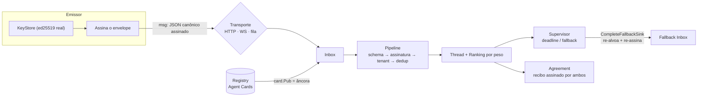

# PARLEY

**Linguagem/protocolo de domínio para comunicação entre agentes de IA** —
negociação com contratos híbridos (cláusulas de máquina + linguagem natural),
multi-tenant, agnóstico de transporte (HTTP, WebSocket, filas).

A serialização canônica JSON **é** o protocolo: qualquer plataforma que leia o
[JSON Schema](schema/) fala PARLEY.

[](https://github.com/mrschneider/parley/actions/workflows/ci.yml)
[](https://github.com/mrschneider/parley/releases)
[](LICENSE)
[](https://www.python.org/)
[](sdk/go/)

## Visão geral do runtime



Cada caixa é verificada por testes E2E (`sdk/go/transport/runtime_test.go`) e
pelo demo executável (`cd sdk/go && go run ./demo`, exit 0).

## Índice

- [Linguagem](#linguagem)
- [Modelo de confiança](#modelo-de-confiança-agentes-não-confiáveis)
- [Contratos híbridos](#contratos-híbridos)
- [Schema v0 / v1](#schema-v0--v1)
- [Runtime de produção](#runtime-de-produção-go)
- [Componentes](#componentes)
- [Quickstart](#quickstart)
- [LSP](#lsp--capacidades)
- [Contribuindo](#contribuindo)

## Linguagem

```parley
agent "planner-42" as PLANNER
agent "dispatcher-7" as DISPATCHER
provides "route.plan" v1
  input  origin : Location
  output route  : Route
  cost   latency_ms <= 200

PLANNER -> DISPATCHER
  request route.plan
  intent "Rota mais rápida, usuário apressado"
  with origin = "Lisboa", dest = "Porto"
  by 2026-10-22T15:00:00Z
  expect confidence > 0.85
  expect route.eta_min <= 150 w 0.9
  expect nl "Evitar obras nas próximas 24h" w 0.9
  fallback -> "dispatcher-backup"
```

Exemplo completo em [`examples/negociacao.parley`](examples/negociacao.parley)
(request → propose → accept seletivo).

## Modelo de confiança (agentes NÃO confiáveis)

- **id de mensagem por conteúdo** (`msg:` + sha256 da serialização canônica) →
  idempotência e detecção de replay
- **assinatura** ed25519 sobre a serialização canônica (todo campo exceto
  `signature`):
  - **modo teste**: chave derivada do id (conveniente, NÃO seguro — qualquer um
    que conheça o id forja a assinatura)
  - **modo produção**: `KeyStore` (Python e Go) gera/carrega pares ed25519
    reais; a pública vai para o **Agent Card** publicado no **Registry** e o
    receptor verifica via `card.Pub` (`Registry.VerifyMessageWithCard`) — a
    âncora de confiança é o card registrado, não a derivação
- **tenant** no envelope, exigível pelo validador
- **provenance**: cadeia de ids que fundamenta a mensagem (também expressa a
  filiação de um `accept` sem `parent` explícito)

## Contratos híbridos

- cláusula `check` — validada por máquina (caminho no body, operador, valor);
  em **v1** aceita composição recursiva `all_of` (E) / `any_of` (OU)
- cláusula `nl` — linguagem natural; só fica **VINCULANTE** quando a contraparte
  a lista explicitamente em `accept ... clauses "cN"`
- **ranking por peso** (`clause.weight`): `rank_proposals` ordena as propostas
  pela fração de peso contratual satisfeita. O ranking **orienta**, o requestor
  decide. Semântica idêntica em Python (referência) e Go.
- **acordo materializado** (`build_agreement` / `BuildAgreement`): ao assentar,
  a negociação vira um recibo canônico de conteúdo endereçado (`agreement:` +
  sha256) com vencedor, corpo aceito e cláusulas binding — assinado por
  requestor **e** provider, verificável sem replayer a thread.

## Schema v0 / v1

| Versão | Arquivo | Diferença |
|---|---|---|
| v0 | [`schema/parley-v0.schema.json`](schema/parley-v0.schema.json) | `check` folha única (`field` + `op`) |
| v1 | [`schema/parley-v1.schema.json`](schema/parley-v1.schema.json) | adiciona `check` composto (`all_of`/`any_of`); v0 rejeita composição |

Seletor automático pelo campo `v` da mensagem, nos dois SDKs.

## Runtime de produção (Go)

Os três pilares se conectam num caminho único:

1. **KeyStore** gera/carrega pares ed25519 reais (JSON, chmod 0600);
2. **Registry** publica o Agent Card assinado e serve de âncora de confiança
   (`WithCardRegistry` no Inbox);
3. **Supervisor** vigia deadline/fallback e o `CompleteFallbackSink` re-alvoa,
   re-assina e entrega a escalada automaticamente;
4. **Agreement** materializa o desfecho assinado por ambos os lados.

Persistência: escritas **atômicas e serializadas entre processos**
(`AtomicWriteFile`/`lockedWrite` — lock-irmão `.lock` + temp/rename). O Inbox
aceita política de retenção (`WithRetention(maxAge, maxRecords)`) com sweep
automático por entrega e `Sweep()` manual.

## Componentes

| Caminho | O que é |
|---|---|
| `parley.py` | Referência Python: parser, canonical JSON, assinatura, `KeyStore`, validação (v0/v1), ranking, thread, acordos |
| `parley_lsp.py` | **LSP** para `.parley` (zero deps, stdio) + `--check` one-shot |
| `test_parley.py` | Testes da referência Python (16) |
| `test_lsp.py` | Testes do LSP com cliente JSON-RPC real (7) |
| `schema/` | JSON Schemas canônicos (v0 e v1) |
| `sdk/go/` | SDK Go: parser, validação, ranking, registry, keystore, agreement, transports |
| `sdk/go/transport/` | Queue + HTTP + **WebSocket** (gorilla), Inbox (retenção), Supervisor |
| `vscode/` | Extensão VS Code: syntax highlighting, LSP, snippets |

## Quickstart

```sh
# referência Python (16 testes)
python3 test_parley.py
python3 parley.py examples/negociacao.parley --thread

# LSP (7 testes)
python3 test_lsp.py
python3 parley_lsp.py --check examples/negociacao.parley   # one-shot
python3 parley_lsp.py                                       # server stdio

# SDK Go (suíte completa) + demo E2E com chaves reais
cd sdk/go && go test ./...
cd sdk/go && go run ./demo
```

## LSP — capacidades

- `textDocumentSync` full → `publishDiagnostics` a cada open/change
  - sintaxe (varredura tolerante: **todos** os erros, não só o primeiro)
  - semântica: `@msgN` fora do alcance, fallback para agente não declarado,
    peso de cláusula fora de (0,1], `request` sem target, cláusula inexistente no pai
- `completion` — keywords por contexto (top / capability / mensagem),
  nomes de capabilities no ato, ids de agentes no `fallback`
- `hover` — docs de keywords, agentes, capabilities, referências `@msgN`
- `documentSymbol` — agentes (com provides), capabilities, mensagens

**Regra numérica canônica** (protocolo): números serializam por *valor* —
inteiros puros (`150`, nunca `150.0`), não-inteiros na menor representação
round-trip (`0.85`). É ela que torna ids/assinaturas independentes de plataforma.

## Contribuindo

Veja [CONTRIBUTING.md](CONTRIBUTING.md) (setup, regras de compatibilidade
Python↔Go, checklist de PR). Bugs e features: [abrir uma issue](https://github.com/mrschneider/parley/issues).
Segurança: [SECURITY.md](SECURITY.md). Changelog: [CHANGELOG.md](CHANGELOG.md).

## Licença

MIT — veja [LICENSE](LICENSE).