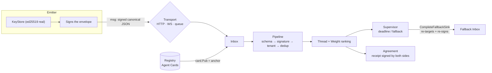

# PARLEY

**Domain-specific language/protocol for AI agent communication** —
negotiation with hybrid contracts (machine clauses + natural language),
multi-tenant, transport-agnostic (HTTP, WebSocket, queues).

The canonical JSON serialization **is** the protocol: any platform that reads the
[JSON Schema](schema/) speaks PARLEY.

[](https://github.com/mrschneider/parley/actions/workflows/ci.yml)
[](https://github.com/mrschneider/parley/releases)
[](LICENSE)
[](https://www.python.org/)
[](sdk/go/)

## Runtime overview



Each box is verified by E2E tests (`sdk/go/transport/runtime_test.go`) and
by the executable demo (`cd sdk/go && go run ./demo`, exit 0).

## Contents

- [Language](#language)
- [Trust model](#trust-model-untrusted-agents)
- [Hybrid contracts](#hybrid-contracts)
- [Schema v0 / v1](#schema-v0--v1)
- [Production runtime](#production-runtime-go)
- [Components](#components)
- [Quickstart](#quickstart)
- [LSP](#lsp--capabilities)
- [Contributing](#contributing)

## Language

```parley
agent "planner-42" as PLANNER
agent "dispatcher-7" as DISPATCHER
provides "route.plan" v1
  input  origin : Location
  output route  : Route
  cost   latency_ms <= 200

PLANNER -> DISPATCHER
  request route.plan
  intent "Fastest route, hurried user"
  with origin = "Lisbon", dest = "Porto"
  by 2026-10-22T15:00:00Z
  expect confidence > 0.85
  expect route.eta_min <= 150 w 0.9
  expect nl "Avoid roadworks in the next 24h" w 0.9
  fallback -> "dispatcher-backup"
```

Full example in [`examples/negotiation.parley`](examples/negotiation.parley)
(request → propose → selective accept).

## Trust model (untrusted agents)

- **content-based message id** (`msg:` + sha256 of the canonical serialization) →
  idempotency and replay detection
- **ed25519 signature** over the canonical serialization (every field except
  `signature`):
  - **test mode**: key derived from the id (convenient, NOT secure — anyone who
    knows the id can forge the signature)
  - **production mode**: `KeyStore` (Python and Go) generates/loads real ed25519
    key pairs; the public key goes into the **Agent Card** published in the
    **Registry** and the receiver verifies via `card.Pub`
    (`Registry.VerifyMessageWithCard`) — the trust anchor is the registered
    card, not the derivation
- **tenant** in the envelope, enforceable by the validator
- **provenance**: chain of ids that grounds the message (also expresses the
  lineage of an `accept` without an explicit `parent`)

## Hybrid contracts

- `check` clause — machine-validated (path in the body, operator, value);
  in **v1** it accepts recursive composition `all_of` (AND) / `any_of` (OR)
- `nl` clause — natural language; it is **BINDING** only when the counterparty
  explicitly lists it in `accept ... clauses "cN"`
- **weight ranking** (`clause.weight`): `rank_proposals` orders proposals by
  the fraction of contractual weight satisfied. The ranking **guides**, the
  requestor decides. Identical semantics in Python (reference) and Go.
- **materialized agreement** (`build_agreement` / `BuildAgreement`): on
  settlement, the negotiation becomes a canonical content-addressed receipt
  (`agreement:` + sha256) with the winner, accepted body, and binding clauses —
  signed by requestor **and** provider, verifiable without replaying the thread.

## Schema v0 / v1

| Version | File | Difference |
|---|---|---|
| v0 | [`schema/parley-v0.schema.json`](schema/parley-v0.schema.json) | single leaf `check` (`field` + `op`) |
| v1 | [`schema/parley-v1.schema.json`](schema/parley-v1.schema.json) | adds composite `check` (`all_of`/`any_of`); v0 rejects composition |

Automatic selection by the message `v` field, in both SDKs.

## Production runtime (Go)

The three pillars connect into a single path:

1. **KeyStore** generates/loads real ed25519 key pairs (JSON, chmod 0600);
2. **Registry** publishes the signed Agent Card and serves as the trust anchor
   (`WithCardRegistry` in the Inbox);
3. **Supervisor** watches deadline/fallback and `CompleteFallbackSink`
   re-targets, re-signs, and delivers the escalation automatically;
4. **Agreement** materializes the outcome signed by both sides.

Persistence: **atomic writes serialized across processes**
(`AtomicWriteFile`/`lockedWrite` — sibling `.lock` + temp/rename). The Inbox
supports a retention policy (`WithRetention(maxAge, maxRecords)`) with
automatic sweep per delivery and manual `Sweep()`.

## Components

| Path | What it is |
|---|---|
| `parley.py` | Python reference: parser, canonical JSON, signature, `KeyStore`, validation (v0/v1), ranking, thread, agreements |
| `parley_lsp.py` | **LSP** for `.parley` (zero deps, stdio) + one-shot `--check` |
| `test_parley.py` | Python reference tests (16) |
| `test_lsp.py` | LSP tests with a real JSON-RPC client (7) |
| `schema/` | Canonical JSON Schemas (v0 and v1) |
| `sdk/go/` | Go SDK: parser, validation, ranking, registry, keystore, agreement, transports |
| `sdk/go/transport/` | Queue + HTTP + **WebSocket** (gorilla), Inbox (retention), Supervisor |
| `vscode/` | VS Code extension: syntax highlighting, LSP, snippets |

## Quickstart

```sh
# Python reference (16 tests)
python3 test_parley.py
python3 parley.py examples/negotiation.parley --thread

# LSP (7 tests)
python3 test_lsp.py
python3 parley_lsp.py --check examples/negotiation.parley   # one-shot
python3 parley_lsp.py                                       # server stdio

# Go SDK (full suite) + E2E demo with real keys
cd sdk/go && go test ./...
cd sdk/go && go run ./demo
```

## LSP — capabilities

- `textDocumentSync` full → `publishDiagnostics` on every open/change
  - syntax (tolerant scan: **all** errors, not just the first)
  - semantics: `@msgN` out of scope, fallback to an undeclared agent,
    clause weight outside (0,1], `request` without a target, clause missing in the parent
- `completion` — context-aware keywords (top / capability / message),
  capability names on the spot, agent ids in `fallback`
- `hover` — docs for keywords, agents, capabilities, `@msgN` references
- `documentSymbol` — agents (with provides), capabilities, messages

**Canonical number rule** (protocol): numbers serialize by *value* —
pure integers (`150`, never `150.0`), non-integers in the shortest round-trip
representation (`0.85`). This is what makes ids/signatures platform-independent.

## Contributing

See [CONTRIBUTING.md](CONTRIBUTING.md) (setup, Python↔Go compatibility
rules, PR checklist). Bugs and features: [open an issue](https://github.com/mrschneider/parley/issues).
Security: [SECURITY.md](SECURITY.md). Changelog: [CHANGELOG.md](CHANGELOG.md).

## License

MIT — see [LICENSE](LICENSE).
